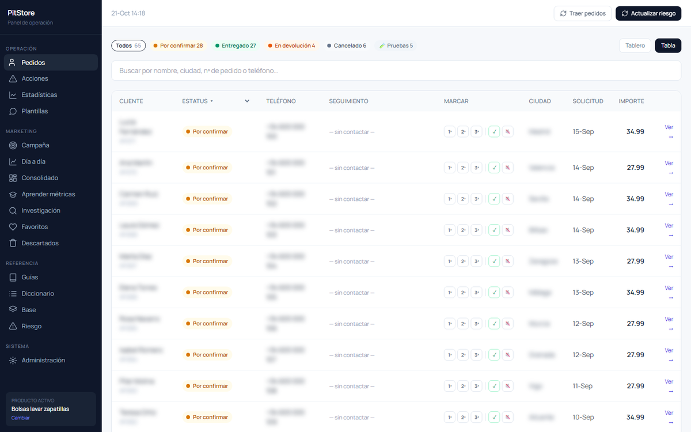
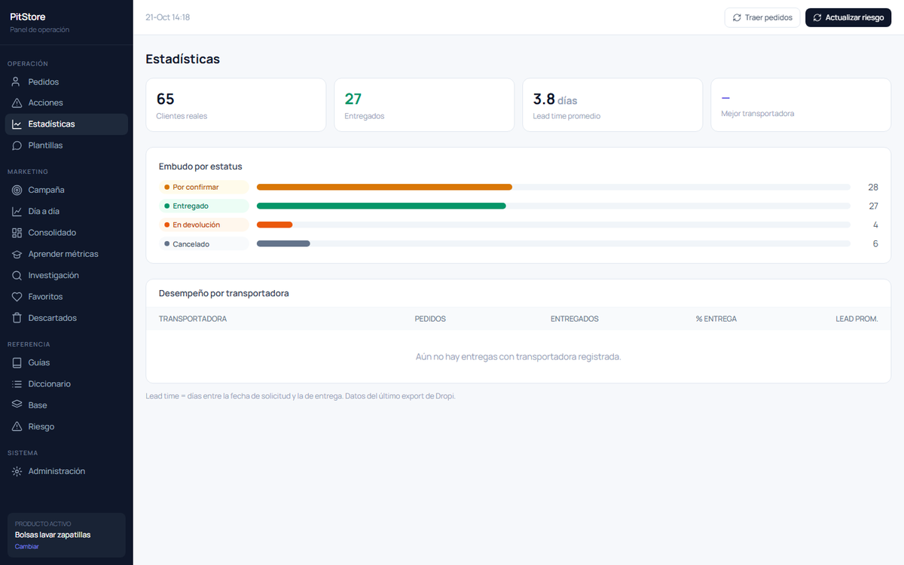
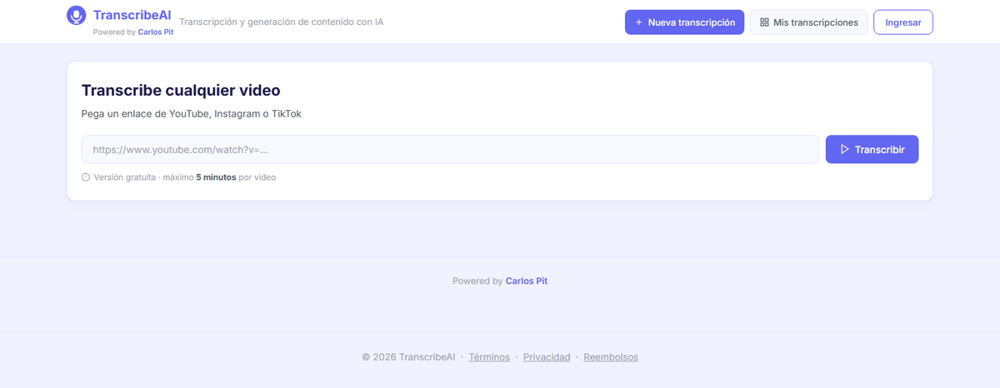
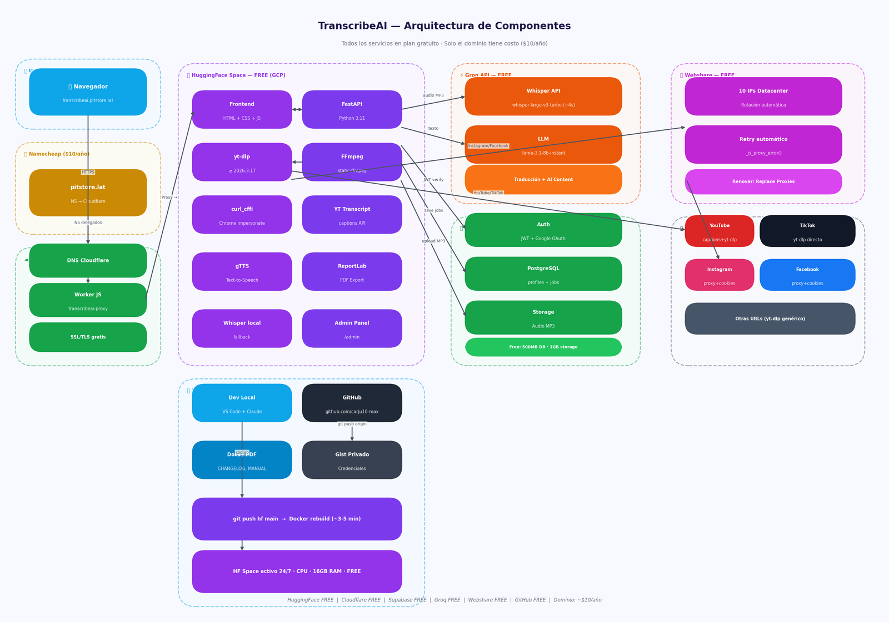
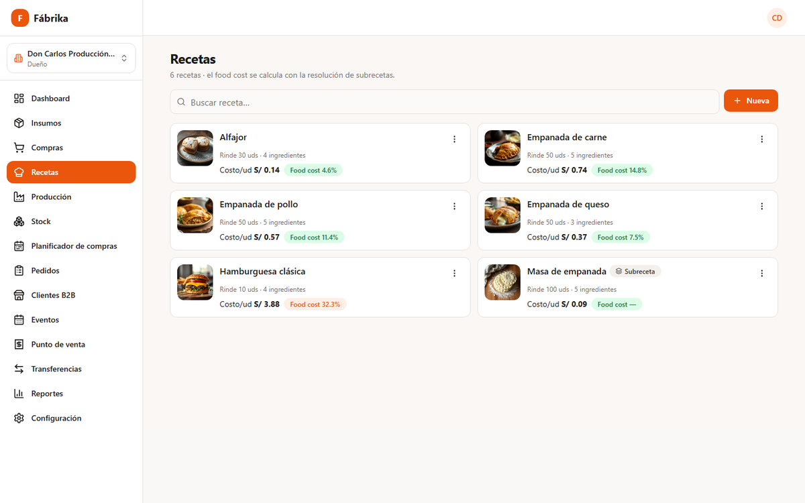
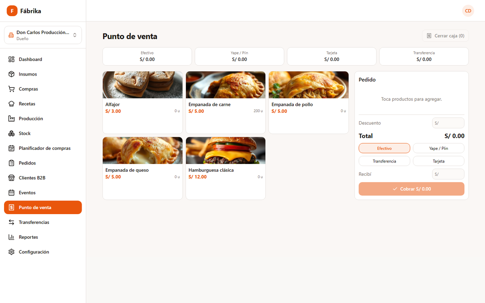

# Hola, soy Carlos Díaz Salazar 👋

**Ex Big Four · Builder de producto e infraestructura con IA**

Vengo de la consultoría en una firma Big Four, donde aprendí a entender procesos de negocio complejos, trabajar con rigor y entregar resultados medibles. Hoy aplico esa disciplina a construir software propio: diseño, desarrollo y opero las herramientas que sostienen mi e-commerce de venta contraentrega en Perú, Ecuador y España, un negocio donde **WhatsApp es el canal principal de venta y de atención**.

Trabajo con un enfoque *AI-first* (Claude Code y agentes) y con ownership de punta a punta: identifico el problema, decido qué construir, lo llevo a producción y lo mejoro con datos de uso real.

---

## 📦 PitStore CRM: operación de pedidos contraentrega
*Uso diario en producción · código privado (maneja datos de clientes)*

En la venta contraentrega el dinero se pierde en los paquetes que vuelven. Este CRM concentra toda la operación en un solo lugar: los pedidos de Shopify, la confirmación por WhatsApp, la logística y la rentabilidad real de las campañas.

- **Pedidos por estado** (por confirmar, entregado, en devolución), con plantillas de WhatsApp para cada etapa y registro de cada contacto.
- **Puntaje de riesgo de entrega:** consulta el historial del comprador en la plataforma logística y marca los pedidos riesgosos antes de despacharlos.
- **Alertas de dirección:** detecta códigos postales o direcciones que van a terminar en entrega fallida.
- **Rentabilidad real:** cruza el gasto de Meta Ads por anuncio con lo efectivamente entregado y cobrado.
- **Multi-tienda y multi-producto:** Perú, Ecuador y España, con datos aislados por tienda.

  
  

Los datos de clientes están reemplazados y difuminados.

`Python` `FastAPI` `Shopify Admin API` `Meta Marketing API` `Telegram Bot API`

---

## 🎙️ TranscribeAI: transcripción y contenido con IA
[**Demo en vivo**](https://huggingface.co/spaces/CarlosDiazSalazar/TranscribeAI)

Convierte videos de YouTube, TikTok, Instagram y Facebook en texto sincronizado palabra a palabra. A partir de ese texto genera traducciones, contenido con IA, audio y PDF. Es un SaaS completo: autenticación con Google, planes y panel de administración. Toda la infraestructura corre en planes gratuitos; el único costo es el dominio.

  

  
<b>Ver la arquitectura</b>

  

`FastAPI` `Whisper (Groq)` `Llama 3.1` `yt-dlp` `FFmpeg` `Supabase (Postgres + Auth + Storage)` `Docker` `Cloudflare Workers`

---

## 🥟 Fábrika: SaaS de gestión para productores de alimentos y restaurantes
*Código privado*

Responde las preguntas que todo productor se hace cada día: **cuánto producir, cuánto comprar, cuánto tengo en la calle y cuánto me deben.** Cubre el flujo completo del negocio:

`INSUMOS → RECETAS → PRODUCCIÓN → STOCK → VENTA / DISTRIBUCIÓN → COBRO`

- **Recetas y subrecetas** con resolución recursiva (incluida la detección de ciclos) y food cost automático.
- **Costeo por última compra:** las órdenes ya completadas conservan su costo histórico.
- **Planificador de compras:** a partir de la producción proyectada calcula los insumos necesarios y los envía por WhatsApp o PDF.
- **Punto de venta**, clientes B2B, liquidaciones, cobranzas y eventos.
- **Multi-tenant**, con planes, límites y onboarding.
- **Tests** sobre la lógica crítica: conversión de unidades, food cost y reglas de precio.

  
  

`Next.js 14` `TypeScript` `PostgreSQL` `Prisma` `Auth.js` `Tailwind` `shadcn/ui` `Cloudflare Workers`

---

## 🛎️ Otros proyectos públicos

| Proyecto | Qué resuelve | Stack |
|---|---|---|
| [**pitstore-watcher**](https://github.com/carju10-max/pitstore-watcher) | Vigilante de pedidos 24/7: detecta cada pedido nuevo de Shopify y avisa por Telegram con el mensaje de WhatsApp ya escrito. | Python · GitHub Actions · Shopify API |
| [**aldoklio-analyzer**](https://github.com/carju10-max/aldoklio-analyzer) | Separa canciones en pistas con IA y detecta tonalidad, BPM y acordes. [Demo](https://huggingface.co/spaces/CarlosDiazSalazar/aldoklio-analyzer) | PyTorch · Demucs · Gradio |

### ⚙️ Herramientas
`Python` `TypeScript` `FastAPI` `Next.js` `PostgreSQL` `Docker` `GitHub Actions` `Cloudflare` `Supabase` `Claude Code`
